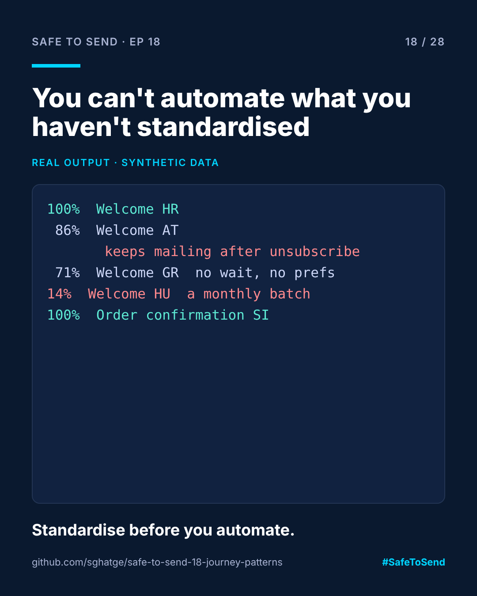

# safe-to-send-18 · Journey Patterns



**Safe to Send · Episode 18** — a 28-day learn-in-public series on governing AI in CRM operations.

> AI can't automate chaos. It just scales it.

## The real-world scenario

Four markets each built their own welcome journey. One has two emails back to back with no wait. One never exits when someone unsubscribes. One isn't triggered by signup at all; it's a monthly batch. Ask an agent to "check all welcome journeys" and it has no shared definition of what a welcome journey is.

## The use case

Define each common journey once: the steps it needs, in order, plus guards every version must have (exit on unsubscribe, consent check). Then score each market's real journey against the pattern.

Ten patterns are included: welcome, reactivation, abandoned cart, post-purchase, birthday, win-back, transactional, newsletter, product launch and preference update.

## Run it

```bash
python journey_patterns.py examples/welcome_journeys.json
```

## Real example output

```
100%  Welcome HR                   welcome        conforms
 71%  Welcome GR                   welcome        wait, preference_center
 86%  Welcome AT                   welcome        guard:exit_on_unsubscribe
 14%  Welcome HU                   welcome        trigger:signup, wait, email, preference_center, guard:exit_on_unsubscribe, guard:consent_check
100%  Order confirmation SI        transactional  conforms
```

Austria's journey looks the most thorough, with extra waits and a preference step, and is the one that keeps emailing people after they unsubscribe. Conformance scores make that visible across markets in one line each.

## Adapt it

Edit `PATTERNS` to match your own standards. The point isn't these ten, it's having one written definition per journey that checks and agents can share. For a deeper, Adobe Campaign v8–specific treatment, see the Campaign Frameworks Atlas.

MIT · [Sangram Ghatge](https://www.linkedin.com/in/sangram-g-2369705b) · #SafeToSend
